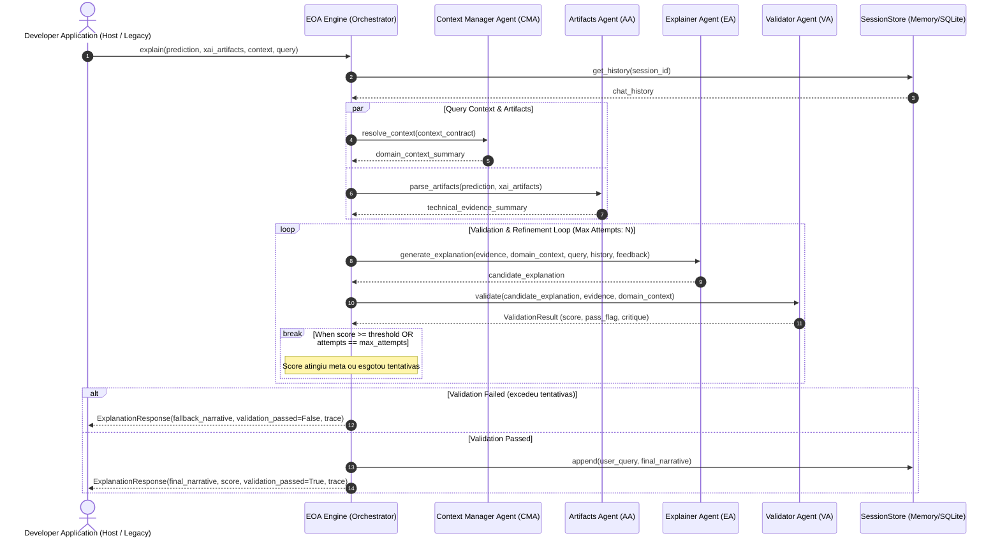
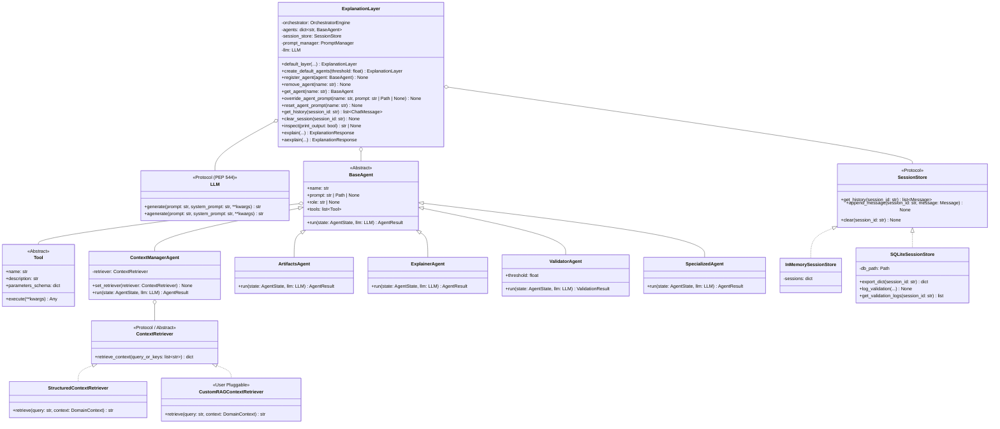

# EOA Framework - Technical Specification & Architecture Design

Este documento formaliza as decisões de arquitetura de software, contratos de dados, interfaces e diagramas do framework **EOA (Explanation-Oriented Agents)**, servindo como base técnica para a implementação e para o paper do **ICSE**.

---

## 1. Visão Geral da Arquitetura

O framework implementa a **Explanation Agent Layer** descrita no paper do SBES como uma camada de software autônoma, extensível e desacoplada (*unplugged*). 

### 1.1 Fluxo de Execução e Loop de Validação

#### A. Visão em Diagrama de Sequência Formal (Mermaid - Renderizável no GitHub/VS Code Preview)


#### B. Visão Rápida em Texto Monoespaçado (Leitura Direta no Editor)
```text
==========================================================================================================
FLUXO DE EXECUÇÃO DETALHADO DO EOA (ORQUESTRAÇÃO E QUALITY GATE)
==========================================================================================================

 [ APLICAÇÃO DO DEV ]
          │
          │ 1. explain(predição, artefatos_xai, contexto, pergunta)
          ▼
 ┌────────────────────────────────────────────────────────────────────────┐
 │                      ORCHESTRATOR ENGINE (Backbone)                    │
 └────────┬───────────────────────────────┬───────────────────────────────┘
          │                               │
          │ 2. Busca histórico do chat    │ 3. Dispara consultas em paralelo
          ▼                               ▼
 ┌───────────────────┐        ┌─────────────────────────┬─────────────────────────┐
 │   SessionStore    │        │ ContextManagerAgent     │ ArtifactsAgent (AA)     │
 │ (SQLite / Memory) │        │ (CMA)                   │                         │
 └───────────────────┘        │ Resolve manuais, regras │ Processa SHAP/LIME,     │
                              │ e esquemas de sensores  │ predição e métricas     │
                              └───────────┬─────────────┴───────────┬─────────────┘
                                          │                         │
                                          └────────────┬────────────┘
                                                       │ 4. Evidências + Contexto
                                                       ▼
                                      ┌───────────────────────────────────┐
                                      │ ExplainerAgent (EA)               │
                                      │ Redige rascunho da narrativa      │
                                      └────────────────┬──────────────────┘
                                                       │
                                                       │ 5. Avalia fidelidade e alucinação
                                                       ▼
                                      ┌───────────────────────────────────┐
                      ┌───────────────┤ ValidatorAgent (VA - Quality Gate)│◄────────────┐
                      │               │ Calcula nota (0 a 10) e feedback  │             │
                      │               └────────────────┬──────────────────┘             │
                      │                                │                                │
                      │ [Nota < 7.0] Reprovado         │ [Nota >= 7.0] Aprovado         │
                      │ (Tentativas < 3)               │                                │
                      ▼                                ▼                                │
      ┌───────────────────────────────┐     ┌───────────────────────────────────┐       │
      │ Envia crítica e erros do VA   │     │ Salva no SessionStore e entrega   │       │
      │ de volta ao Explainer (EA)    │     │ ExplanationResponse final         │       │
      └───────────────┬───────────────┘     └─────────────────┬─────────────────┘       │
                      │                                       │                         │
                      └───────────────────────────────────────┴─────────────────────────┘
                                       Loop de Refinamento (Máx 3 vezes)
==========================================================================================================
```

### Passo a Passo Explicado:
1. **Disparo**: O desenvolvedor passa os dados de predição e XAI brutos para `layer.explain(...)`.
2. **Histórico**: O orquestrador busca mensagens anteriores daquela sessão no `SessionStore` (arquivo `.db`).
3. **Consulta Paralela**: O `ContextManagerAgent` (CMA) e o `ArtifactsAgent` (AA) extraem as evidências e regras técnicas em paralelo.
4. **Síntese**: O `ExplainerAgent` (EA) redige uma primeira proposta de explicação contextualizada.
5. **Quality Gate (Validador)**: O `ValidatorAgent` (VA) audita se a explicação condiz com os dados ou se houve alucinação, atribuindo uma nota de 0 a 10.
   - **Se nota >= 7.0**: Aprovado! Salva a mensagem no histórico e entrega ao usuário.
   - **Se nota < 7.0**: O validador envia as correções de volta para o EA reescrever (até 3 tentativas). Se esgotar as tentativas, ativa o fallback gracioso informando que a nota foi abaixo do ideal sem travar o sistema host.

---

### 1.2 Padrões de Integração da Camada: Modo Direto (Push) vs. Modo Baseado em Consulta (Pull / Query-Based)

Para alinhar com a tese formal do paper do SBES ("*query-based integration where agents retrieve information without intrusive modifications*") e ao mesmo tempo oferecer simplicidade máxima ("Developer is King"), o framework suporta dois padrões complementares de integração:

```text
==========================================================================================================
PADRÕES DE INTEGRAÇÃO DO FRAMEWORK EOA
==========================================================================================================

 [ PADRÃO A: MODO DIRETO (Push) - Simplicidade Imediata ]
 ┌────────────────────────────────────────────────────────┐
 │ Aplicação do Desenvolvedor (Backend / FastAPI)         │
 │ Já executou o modelo de ML e tem o SHAP em mãos        │
 └──────────────────────────┬─────────────────────────────┘
                            │ Passa os dados brutos: explain(prediction={...}, xai={...})
                            ▼
 ┌────────────────────────────────────────────────────────┐
 │ EOA Layer valida os dados e entrega aos Agentes        │
 └────────────────────────────────────────────────────────┘

 [ PADRÃO B: MODO BASEADO EM CONSULTA (Pull / Autônomo do Paper) ]
 ┌────────────────────────────────────────────────────────┐
 │ Aplicação do Desenvolvedor (Backend Industrial)        │
 │ Passa apenas o identificador: explain(incident_id=...) │
 └──────────────────────────┬─────────────────────────────┘
                            │
            ┌───────────────┴───────────────────────────────┐
            ▼                                               ▼
 ┌──────────────────────────────┐               ┌──────────────────────────────────┐
 │ ArtifactsAgent (AA)          │               │ ContextManagerAgent (CMA)        │
 │ Executa Tool/Query no        │               │ Executa Tool/Query na Engenharia │
 │ Analytics Layer e busca XAI  │               │ de Dados e busca schemas/manuais │
 └──────────────┬───────────────┘               └────────────────┬─────────────────┘
                │                                                │
                └───────────────────────┬────────────────────────┘
                                        │ Montam internamente os contratos normalizados:
                                        ▼ PredictionArtifact, XAIArtifact e DomainContext
 ┌────────────────────────────────────────────────────────┐
 │ ExplainerAgent (EA) e ValidatorAgent (VA)              │
 └────────────────────────────────────────────────────────┘

 [ PADRÃO C: MODO CONCEITUAL / RAMPA PROGRESSIVA (Zero ML Inicial) ]
 ┌────────────────────────────────────────────────────────┐
 │ Desenvolvedor no Onboarding ou Consultas de Domínio    │
 │ Passa apenas a dúvida e contexto: explain(query=...)   │
 └──────────────────────────┬─────────────────────────────┘
                            │ prediction=None (Sem modelo de ML pronto ainda)
                            ▼
 ┌────────────────────────────────────────────────────────┐
 │ EOA Layer opera com foco no ContextManagerAgent (CMA), │
 │ gerando explicação de manuais/regras sem exigir ML     │
 └────────────────────────────────────────────────────────┘
==========================================================================================================
```

- **A diferença é quem instancia o contrato**:
  - No Modo Direto: O desenvolvedor passa o dicionário e o EOA preenche o contrato.
  - No Modo Autônomo (Query-Based): Os agentes (AA e CMA) executam suas Tools/Consultas e eles mesmos preenchem o contrato antes de enviar ao Explainer.
  - No Modo Conceitual (Rampa Progressiva): `prediction` e `xai` são opcionais (`None`), permitindo que o desenvolvedor comece a usar a camada apenas com contexto de manuais/regras antes de plugar seus modelos de ML.
- **Decisão Arquitetural**: A implementação das ferramentas de consulta autônoma e rampa flexível será feita no **Épico 06 (Agentes e Tools)**, **Épico 07 (Orquestração)** e **Épico 08 (ExplanationLayer)**.

---

### 1.3 Defesa Arquitetural: EOA vs. Chamada Direta de LLM (Por que não apenas Prompt Engineering?)

Uma pergunta frequente em revisões de Engenharia de Software (ICSE) é: *"Se o cliente já tem a predição e o XAI no modo direto, por que ele não faz apenas uma chamada com prompt formatado para o ChatGPT/Gemini?"*

A resposta técnica baseia-se em 4 pilares de Engenharia de Sistemas Críticos:

1. **Prevenção de Alucinações com Quality Gate Fechado (`ValidatorAgent`)**:
   Uma chamada crua de LLM é estocástica e não supervisionada. O modelo pode inventar causas mecânicas inexistentes com alta convicção. No EOA, a narrativa nunca é entregue sem passar pela auditoria do Validador, que aplica nota e aciona refinamento autônomo com feedback delimitado.
2. **Ponte Semântica de Domínio (`ContextManagerAgent`)**:
   Modelos de linguagem não conhecem siglas proprietárias de plantas industriais (ex.: `PS1`, `EPS1`). O CMA ingere esquemas e manuais de engenharia, resolvendo a correlação física sem inchar a janela de contexto.
3. **Desacoplamento Fail-Safe ("Unplugged")**:
   Falhas de rede, timeouts ou rate limits na API de LLM derrubariam o backend do cliente. O EOA garante degradação graciosa: entrega uma resposta de fallback determinística com os dados brutos e flag `fallback_used = True`, mantendo a operação da planta intacta.
4. **Rastreabilidade de Auditoria (Compliance Industrial)**:
   O `AgentStepTrace` e o `SessionStore` (SQLite local auditável) mantêm registro formal de cada agente, tempo de execução e justificativas técnicas, atendendo a exigências de conformidade regulatória.

---

## 2. Mapa Estrutural de Classes e Protocolos

#### A. Diagrama Formal de Classes (Mermaid)


#### B. Mapa Estrutural Rápido (Texto Monoespaçado)
```text
==========================================================================================================
MAPA DE CLASSES DO FRAMEWORK
==========================================================================================================

 [ Interfaces Base (Protocolos) ]
 ├── LLM                       -> Contrato de chamada ao LLM (PEP 544): generate(prompt) -> str
 ├── ContextRetriever          -> Contrato de busca de contexto: retrieve(query, context) -> str
 └── SessionStore              -> Contrato de persistência de chat: get_history(), append_message()

 [ Implementações de Armazenamento (SessionStore) ]
 ├── InMemorySessionStore      -> Guarda o histórico em RAM (ideal para testes rápidos)
 └── SQLiteSessionStore        -> Salva em arquivo .db local nativo (o desenvolvedor audita via SQL)

 [ Agentes (Herfam de BaseAgent) ]
 ├── ContextManagerAgent (CMA) -> Consulta manuais e esquemas operacionais
 ├── ArtifactsAgent (AA)       -> Processa SHAP, LIME e predições numéricas
 ├── ExplainerAgent (EA)       -> Sintetiza a narrativa final contextualizada em linguagem natural
 ├── ValidatorAgent (VA)       -> Quality Gate (LLM-as-a-Judge com scoring 0-10 e crítica de refinamento)
 └── SpecializedAgent (SA)     -> Agente extra plugado pelo desenvolvedor para subsistemas específicos

 [ Camadas de Orquestração e Fachada ]
 ├── OrchestratorEngine        -> Motor interno que executa o grafo assíncrono e o loop de validação
 └── ExplanationLayer          -> Ponto de entrada amigável para o dev (Fachada DX)
==========================================================================================================
```

---

## 2.1 Os 3 Modos de Conexão com LLM (Flexibilidade Total)

Para garantir que o desenvolvedor tenha controle total ("Developer is King"), o framework suporta 3 modos de inicialização do LLM:

1. **Modo 1: Credenciais Diretas (Chave + Modelo)**:
   - **Variação A (Explícita)**: O desenvolvedor passa chave e modelo no construtor.
   - **Variação B (Zero-Config / Lazy via Env)**: Se omitidos, o framework resolve automaticamente de `GEMINI_API_KEY` e `GEMINI_MODEL` (fallback padrão: `gemini-3.5-flash-lite`).
   ```python
   # Variação A: Chave e modelo explícitos
   layer = eoa.ExplanationLayer(provider="gemini", api_key="AIzaSy...", model="gemini-3.5-flash-lite")

   # Variação B: Leitura automática do ambiente (export GEMINI_API_KEY="...")
   layer = eoa.ExplanationLayer(provider="gemini")
   # ou instanciação zero-config direta via classmethod de 1 linha com agentes padrão:
   layer = eoa.ExplanationLayer.default_layer()
   ```

2. **Modo 2: Cliente Pronto (Bring Your Own Client)**:
   - O desenvolvedor injeta um cliente já autenticado com proxy corporativo, headers customizados ou certificados.
   - O framework não inspeciona nem exige a chave de API, respeitando o encapsulamento do cliente fornecido.
   ```python
   import google.genai as genai
   my_client = genai.Client(api_key="...", http_options={"proxy": "http://proxy.local:8080"})
   layer = eoa.ExplanationLayer(llm=my_client)
   ```

3. **Modo 3: Função Customizada (Custom Callable)**:
   - Suporte universal para qualquer IA (modelos locais em vLLM/Ollama, gateways internos, OpenAI ou Anthropic).
   - Aceita funções síncronas (`def`) ou assíncronas (`async def`), com inspeção dinâmica de assinatura para `prompt` e `system_prompt`.
   ```python
   # Exemplo síncrono para gateway local ou Ollama
   def my_custom_llm(prompt: str, system_prompt: str | None = None) -> str:
       return internal_ai_gateway.predict(prompt)

   layer = eoa.ExplanationLayer(llm=my_custom_llm)
   ```

---

## 2.2 Estratégias de Armazenamento e Recuperação de Informação

O framework separa claramente duas necessidades distintas de dados:

### A. Sessão de Chat e Mensagens (`SessionStore`)
- **Finalidade**: Armazenar o histórico de mensagens multi-turn entre operador e agentes.
- **Implementação Principal (`SQLiteSessionStore`)**:
  - Salva em um arquivo `.db` local via biblioteca padrão do Python (`sqlite3`, sem dependências externas).
  - **O Desenvolvedor Decide**: O banco é dele! Ele pode inspecionar com qualquer cliente SQL, fazer queries analíticas, criar backups ou auditar o que o operador conversou.
- **Implementação Efêmera (`InMemorySessionStore`)**: Mantém em RAM para APIs stateless ou testes unitários.
- **Implementação Customizada**: O dev pode plugar Redis/PostgreSQL via protocolo `SessionStore`.

### B. Recuperação de Manuais e Documentos Grandes (`ContextRetriever` no CMA)
- **Finalidade**: Municiar o `ContextManagerAgent` (CMA) com informações operacionais, manuais técnicos e significado de variáveis.
- **Modo Padrão do Paper (Estruturado - Zero Vetores)**:
  - `StructuredContextRetriever`: Ingere schemas JSON, tabelas e resumos de manuais mapeados. Leve, determinístico e sem dependência de vetores.
- **Modo Adaptável para Manuais Gigantes (RAG / Busca Livre)**:
  - Se a fábrica ou empresa tiver um manual de 500 páginas, o desenvolvedor pode plugar um `ContextRetriever` customizado (ex: usando LangChain Retriever, LlamaIndex, BM25 ou Elasticsearch):
  ```python
  cma = layer.get_agent("context_manager")
  cma.set_retriever(my_rag_retriever_for_500_page_manual)
  ```
- **Conclusão de Design**: O core permanece leve e cumpre o princípio científico do paper (sem forçar 500MB de banco vetorial no `pip install`), mas o desenvolvedor tem a liberdade de plugar RAG se o caso de uso dele exigir!

---

## 2.3 Sistema de Prompts e Agentes Especializados

### A. Diretório de Prompts Default e Versionamento
Para garantir que as instruções dos agentes sejam transparentes, auditáveis e facilmente inspecionadas:
- O pacote empacota um diretório nativo `src/eoa/prompts/` contendo arquivos markdown (`.md`):
  - `context_manager_default.md`: Instruções de resolução e mapeamento de contexto do CMA.
  - `artifacts_default.md`: Instruções de análise de métricas XAI e predições do AA.
  - `explainer_default.md`: Instruções de síntese e tom narrativo do EA.
  - `validator_default.md`: Instruções do Quality Gate e critérios de scoring do VA.
  - `tool_dispatch_default.md`: Instruções genéricas de *Single-Pass Tool-Dispatch Reasoning* para seleção autônoma de ferramentas e extração de parâmetros.
- Todos seguem o formato **PTCF** (*Persona, Task, Context, Format*) e usam placeholders `{variavel}`
  (ex.: `{prediction}`, `{xai}`, `{domain_context}`, `{user_query}`) preenchidos por `PromptManager.render`.
- Nomes completos são a chave canônica de agentes e arquivos: `context_manager`, `artifacts`, `explainer`, `validator`.

### B. Mecanismo de Sobrescrita ("Developer is King")
A customização de prompts é transparente, cirúrgica e direta. A fonte é sempre explícita, nunca adivinhada
(resolvida por `PromptManager.resolve`):
- `None` (padrão): usa o `<agente>_default.md` embutido.
- `str`: o próprio texto do prompt.
- `Path`: arquivo `.md` local, lido imediatamente (erro amigável se não existir ou não for `.md`).

O desenvolvedor pode customizar o prompt de duas formas intuitivas:
1. **Via `layer.override_agent_prompt(name, prompt)` (Na Camada / Padrão Mais Rápido)**:
   ```python
   # Sobrescreve o prompt de um agente já ativo sem reconstruir a camada ou perder tools:
   layer.override_agent_prompt("explainer", Path("meus_prompts/custom_explainer.md"))
   # Ou passando a string diretamente:
   layer.override_agent_prompt("explainer", "Você é um engenheiro mecânico sênior...")
   ```
2. **Via Construtor do Agente (Na Criação / Testes Isolados)**:
   ```python
   # Ao instanciar um agente específico ou especializado:
   ea = ExplainerAgent(prompt=Path("meus_prompts/custom_explainer.md"))
   ```
Callables e arquivos `.txt` ficam fora da v0.1.0 para manter simplicidade, previsibilidade e robustez.

### C. Agentes Especializados (`SpecializedAgent`)
O framework suporta a injeção de agentes dedicados a subsistemas industriais específicos:
- Classe `SpecializedAgent` herda de `BaseAgent`.
- Registro no fluxo: `layer.register_agent(SpecializedAgent(name="turbina_specialist", prompt=Path("...")))`.
  - Como o formato PTCF já define a persona e especialidade no próprio prompt (`## Persona`), o construtor é enxuto e não exige redundância de texto (`role` é opcional).
- No ciclo de orquestração, o `OrchestratorEngine` avalia metadados e aciona os agentes especializados pertinentes ao subsistema do alerta.

---

## 3. Contratos de Dados (Pydantic v2)

### 3.1 `PredictionArtifact`
Representa o output do modelo preditivo analítico (Level 1).
```python
from pydantic import BaseModel, Field
from typing import Any, Dict, Optional

class PredictionArtifact(BaseModel):
    model_name: Optional[str] = None
    target_variable: str
    predicted_value: Any
    confidence_or_probability: Optional[float] = None
    status_label: Optional[str] = None
    metadata: Dict[str, Any] = Field(default_factory=dict)
```

### 3.2 `XAIArtifact`
Representa os artefatos técnicos de explicabilidade bruta (Level 2).
```python
class XAIArtifact(BaseModel):
    method: str = "feature_importance"  # ex: SHAP, LIME, counterfactual, integrated_gradients
    feature_attributions: Dict[str, float] = Field(default_factory=dict)
    baseline_values: Optional[Dict[str, Any]] = None
    counterfactuals: Optional[list] = None
    raw_artifacts: Dict[str, Any] = Field(default_factory=dict)
```

### 3.3 `DomainContext`
Representa o contexto operacional e metadados de domínio (sem vetor denso, puramente estruturado).
```python
class DomainContext(BaseModel):
    variables: Dict[str, str] = Field(default_factory=dict)  # Ex: {"PS1": "Pressão"} ou {"FICO": "Score"}
    thresholds: Dict[str, Any] = Field(default_factory=dict)
    documents: Dict[str, str] = Field(default_factory=dict)  # Ex: {"manual": "Procedimentos"}
    hierarchy: Dict[str, Any] = Field(default_factory=dict)  # Taxonomia de subsistemas
    schemas: Dict[str, Any] = Field(default_factory=dict)    # Schemas de datasets/fontes de dados
```

### 3.4 `ExplanationResponse`
Resultado final entregue à aplicação cliente.
```python
class AgentStepTrace(BaseModel):
    agent_name: str
    execution_time_ms: float
    summary: str
    status: str

class ExplanationResponse(BaseModel):
    narrative: str
    validation_score: Optional[float] = None
    validation_passed: Optional[bool] = None
    validation_critique: Optional[str] = None
    attempts_used: int = 1
    fallback_used: bool = False
    session_id: Optional[str] = None
    execution_trace: list[AgentStepTrace] = Field(default_factory=list)
```

---

## 4. Estratégia de Fallback e Degradação Graciosa

Em conformidade com o princípio de sistema crítico do paper:
1. **Falha de Conectividade com LLM**: Se o LLM falhar por timeout, rate limit ou erro de rede, o método `explain` captura a exceção e retorna um fallback determinístico formatado contendo os dados brutos de predição e XAI com aviso explícito de indisponibilidade da camada narrativa.
2. **Falha de Qualidade (Score < Threshold após N tentativas)**: Se o `ValidatorAgent` rejeitar a explicação após o número máximo de tentativas configurado, o framework retorna a melhor narrativa obtida acompanhada dos alertas gerados pelo validador, com `validation_passed = False`, permitindo que a interface cliente alerte o operador sobre a ressalva técnica.
